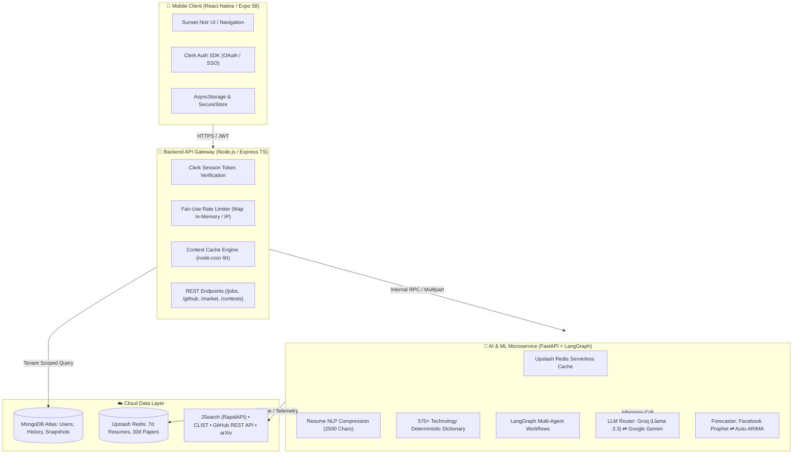

<div align="center">

# ⚡ Joblio

### **AI-Powered Developer Intelligence & Career Matching Platform**

[](https://fastapi.tiangolo.com/)
[](https://expressjs.com/)
[](https://expo.dev/)
[](https://reactnative.dev/)
[](https://www.typescriptlang.org/)
[](https://python.langchain.com/)
[](https://upstash.com/)
[](https://www.mongodb.com/)
[](https://opensource.org/licenses/MIT)

**Joblio** is an enterprise-grade, full-stack intelligence platform that bridges the gap between software developers and the tech industry. It combines real-time developer telemetry, multi-agent LLM workflows, machine learning market forecasting, and high-precision career matching into a sleek, Sunset Noir mobile ecosystem.

[Architecture](#-system-architecture) • [Features](#-core-capabilities) • [Tech Stack](#-technical-stack) • [Installation](#-getting-started) • [Deployment](#-cloud-deployment) • [Authors](#-authors)

---

</div>

## 📌 System Architecture

Joblio operates on a distributed microservice topology designed for horizontal scalability, sub-second latency, and token efficiency:



---

## ✨ Core Capabilities

### 1. 💼 AI-Powered Resume Matching & Job Radar
- **Sticky Resume Persistence**: Candidates upload a resume once (PDF, DOCX, TXT); it remains attached and synced across all app sessions until deliberately updated.
- **Multi-Dimensional Filtering**: Search jobs and internships by Workplace (`Remote`, `Hybrid`, `Onsite`), Opportunity Type (`Jobs`, `Internships`), Geography (`India 🇮🇳`, `Global`), and Source (`LinkedIn`, `Y Combinator`, `Internshala`).
- **English-Only Guarantee**: Automated Latin-character filters exclude foreign-language or non-Latin listings.

### 2. 📈 Market Intelligence & ML Forecaster
- **Live Tech Telemetry**: Continuous scraping of active engineering openings via RapidAPI JSearch.
- **Two-Pass NLP Extractor**: Recognizes 570+ frameworks, databases, languages, and cloud libraries.
- **Adaptive Machine Learning Engine**:
  - **Facebook Prophet**: Weekly additive seasonality model for skills with $\ge 16$ weeks of historical data.
  - **Auto-ARIMA**: Automated AIC order minimization for skills with $\ge 12$ weeks.
  - **Linear Regression**: Baseline velocity trend for emerging technologies ($\ge 4$ weeks).
- **26-Week Forward Projections**: Computes 80% confidence interval bands, demand velocity, and momentum indices.

### 3. 🔍 GitHub Developer Profiler & Audit
- **Engineering Hygiene Score**: Audits public GitHub profiles based on commit velocity, README documentation, testing, and CI/CD coverage (0–100 score).
- **Automated Fix Generation**: Generates production-ready GitHub Actions CI/CD workflows and profile `README.md` files.

### 4. 🏆 Competitive Programming Radar
- **Multi-Platform Scraping**: Aggregates live upcoming contests from **LeetCode**, **Codeforces**, **CodeChef**, and **AtCoder** via CLIST API.
- **Background Cron Updates**: Pre-computes and caches contest schedules every 6 hours, serving listings in under **10ms**.

### 5. 📄 Research Paper Explainer
- **arXiv Integration**: Explores computer science and AI research papers.
- **Hierarchical Extraction**: Breaks papers down into problem formulation, core methodology, architectural pipeline steps, and developer takeaways.
- **30-Day Redis Caching**: Popular papers are cached in Upstash, slashing token consumption to **zero** on repeat queries.

### 6. 🛡️ Token Optimization & Scalability Suite
- **Prompt Pruning**: Strips legal boilerplate and disclaimers from resumes, slashing prompt tokens by **~60%**.
- **Hybrid Parsing**: Runs deterministic dictionary lookups first; falls back to LLM inference only when needed.
- **Fair-Use Quotas**: Express rate limiting prevents quota exhaustion (15 resume matches/day, 10 audits/day).

---

## 🛠️ Technical Stack

| Layer | Technologies | Purpose |
| :--- | :--- | :--- |
| **Mobile Client** | React Native 0.88, Expo SDK 58, TypeScript | Cross-platform iOS & Android mobile application |
| **Authentication** | Clerk Expo SDK, Clerk Express Middleware | Passwordless, Google OAuth, GitHub OAuth & JWT sessions |
| **Backend API** | Node.js 20+, Express 4, TypeScript | Secure API gateway, validation, cron schedulers |
| **AI Microservice** | Python 3.11+, FastAPI, LangGraph | Multi-agent execution pipelines & document parsing |
| **LLM Inference** | Groq (Llama 3.3 70B Versatile), Google Gemini 1.5 | High-speed, cost-effective language models |
| **Machine Learning** | Prophet, Statsmodels (ARIMA), Scikit-learn, Pandas | Time-series trend analysis & demand forecasting |
| **Caching Layer** | Upstash Redis (Serverless REST) | Token elimination for resumes and research papers |
| **Database** | MongoDB Atlas, Motor (Async IO), Mongoose | Persistent document store with multi-tenant isolation |
| **Build & Release** | Expo Application Services (EAS Build) | Automated Android APK and AAB compilation |

---

## 📂 Repository Structure

```text
Joblio-app/
├── innovatex/
│   ├── backend/                     # Node.js Express TypeScript Gateway
│   │   ├── src/
│   │   │   ├── controllers/         # auth, jobs, github, market, reports
│   │   │   ├── middleware/          # authMiddleware (Clerk), quotaMiddleware
│   │   │   ├── models/              # User, ContestCache, MarketSnapshot, JobSearchHistory
│   │   │   ├── routes/              # Express API endpoints & /privacy legal page
│   │   │   └── utils/               # contestFetcher, safeUser sanitization
│   │   ├── package.json
│   │   └── tsconfig.json
│   │
│   ├── mobile/                      # React Native / Expo Mobile App
│   │   ├── assets/                  # App icon (512x512), splash, adaptive launcher
│   │   ├── src/
│   │   │   ├── components/          # Reusable UI widgets & AppHeader
│   │   │   ├── config/              # API configuration & Clerk base64 decoder
│   │   │   ├── constants/           # Sunset Noir theme tokens (COLORS, FONTS)
│   │   │   ├── context/             # AuthContext (Clerk + Mongo session sync)
│   │   │   ├── navigation/          # AppNavigator (Role-gated onboarding routing)
│   │   │   ├── screens/             # Auth, Onboarding, Jobs, Contests, Market, Profile
│   │   │   └── services/            # Axios API clients & multipart file uploads
│   │   ├── app.json                 # Expo configuration & deep linking schemes
│   │   ├── eas.json                 # EAS build profiles (APK preview & production AAB)
│   │   └── package.json
│   │
│   └── pythonservices/              # Python FastAPI AI & ML Microservice
│       ├── agents/
│       │   ├── github/              # Repo analyzer, code audit, fix generator
│       │   ├── jobs/                # Resume parser, job searcher, match scorer
│       │   ├── market/              # JSearch scraper, NLP skill extractor, Prophet forecaster
│       │   ├── opensource/          # Good first issue finder & PR guides
│       │   └── research/            # ArXiv paper explainer & related research finder
│       ├── graphs/                  # LangGraph state machine definitions
│       ├── utils/                   # Upstash Redis cache client, MongoDB async client, LLM router
│       ├── main.py                  # FastAPI application entrypoint
│       ├── scheduler.py             # APScheduler background telemetry cron
│       └── requirements.txt
│
└── README.md
```

---

## 🚀 Getting Started

### Prerequisites
- **Node.js**: v18.0.0 or higher
- **Python**: v3.10 or v3.11
- **Package Manager**: `npm`
- **Expo EAS CLI**: `npm install -g eas-cli`

---

### 1. Backend Service Setup
```bash
cd innovatex/backend

# Install dependencies
npm install

# Configure environment
cp .env.example .env
# Fill in MONGO_URI, CLERK_PUBLISHABLE_KEY, CLERK_SECRET_KEY, CLIST credentials

# Run development server
npm run dev

# Compile TypeScript for production
npm run build
```
Backend runs at `http://localhost:5000`. Health check: `http://localhost:5000/api/health`.

---

### 2. Python AI Microservice Setup
```bash
cd innovatex/pythonservices

# Create and activate virtual environment
python -m venv .venv
# Windows:
.venv\Scripts\activate
# Linux/macOS:
source .venv/bin/activate

# Install dependencies
pip install -r requirements.txt

# Configure environment
cp .env.example .env
# Fill in GROQ_API_KEY, GEMINI_API_KEY, RAPIDAPI_KEY, UPSTASH credentials

# Start FastAPI server
uvicorn main:app --host 0.0.0.0 --port 8000 --reload
```
FastAPI docs: `http://localhost:8000/docs`. Health check: `http://localhost:8000/health`.

---

### 3. Mobile App (Expo) Setup
```bash
cd innovatex/mobile

# Install dependencies
npm install

# Configure environment
cp .env.example .env
# Set EXPO_PUBLIC_API_URL and EXPO_PUBLIC_CLERK_PUBLISHABLE_KEY

# Start Expo Development Server
npx expo start
```

---

## 📱 Compiling the Android APK

Joblio is pre-configured with **Expo Application Services (EAS)** for building standalone Android APKs:

```powershell
cd innovatex/mobile

# Build standalone test APK (Cloud builder)
$env:EAS_BUILD_SKIP_LOCKFILE_CHECK=1; npx eas build -p android --profile preview

# Build production App Bundle (.aab) for Google Play Store
npx eas build -p android --profile production
```

---

## ☁️ Cloud Deployment

| Service | Hosting Platform | URL |
| :--- | :--- | :--- |
| **API Gateway** | Render Web Service | `https://joblio-backend.onrender.com` |
| **AI Microservice** | Render Web Service | `https://joblio-ai-service.onrender.com` |
| **Serverless Cache** | Upstash Redis | `https://feasible-pelican-241151.upstash.io` |
| **Database** | MongoDB Atlas | Cluster `cluster0` |
| **Privacy Policy** | Render (Hosted) | `https://joblio-backend.onrender.com/privacy` |

---

## 🛡️ Security & Privacy

- **Data Encryption**: All transit traffic is strictly enforced over TLS/HTTPS.
- **Tenant Isolation**: All database operations scope records by verified Clerk user tokens (`userId`).
- **Secrets Protection**: All `.env` files are strictly excluded from git tracking.
- **Transient AI Processing**: Resumes submitted for parsing are evaluated transiently and cached in encrypted Redis memory; they are never shared with or used to train third-party foundation models.

---

## 👥 Authors

* **Devashish** - [@devashishhaldar2006](https://github.com/devashishhaldar2006) · [LinkedIn](https://linkedin.com/in/devashish-haldar-dev)
* **Om** - [@loqom](https://github.com/loqom) · [LinkedIn](https://linkedin.com/in/om-vishwakarma-codes)

---

## 📄 License

This project is licensed under the MIT License - see the [LICENSE](LICENSE) file for details.
